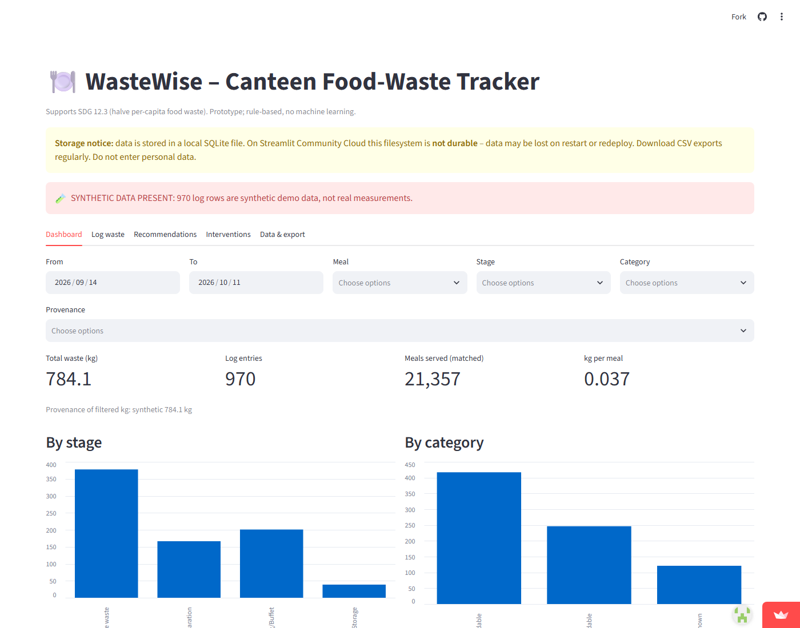
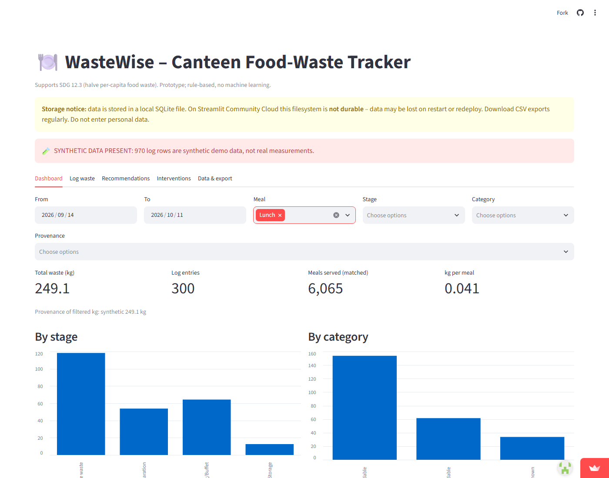
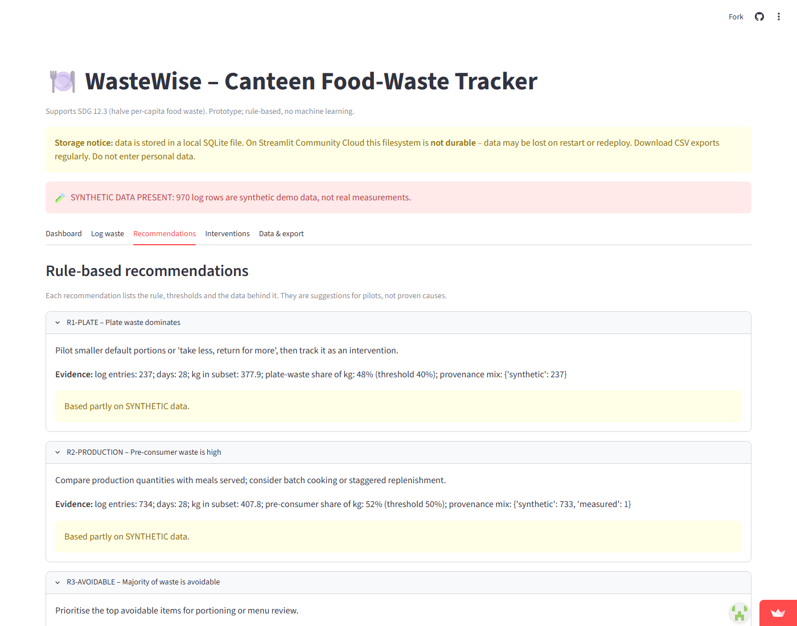
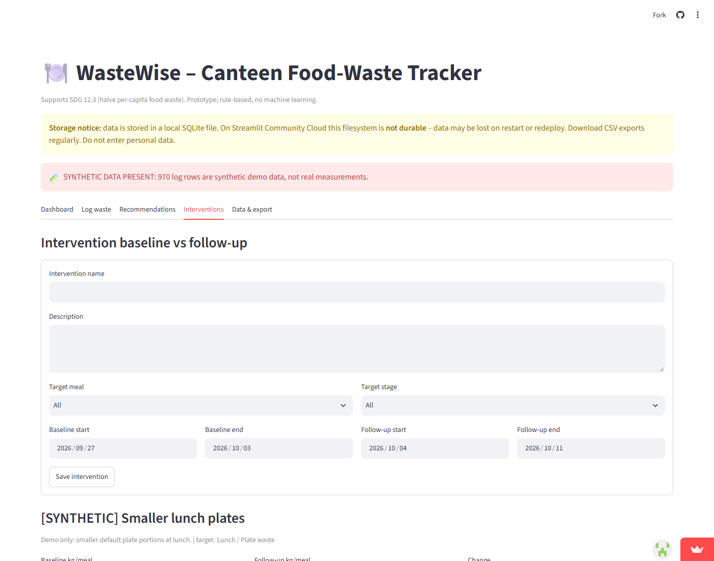

# WasteWise – Canteen Food-Waste Intelligence

A small, transparent Streamlit prototype for logging and analysing food waste in an
institutional canteen (university, hospital, workplace), with local SQLite storage.

> **Status:** working prototype, deployed on Streamlit Community Cloud (demo only; storage is not durable).
>
> - **Live app:** https://wastewise-food-waste-intelligence-qeykaa8immms9xxex9aoin.streamlit.app/
> - **Repository:** https://github.com/commanderbadie/wastewise-food-waste-intelligence

## Context: SDG 12.3

UN Sustainable Development Goal target 12.3 aims to halve per-capita global food waste at
retail and consumer level and reduce food losses along production and supply chains by 2030.
Canteens can contribute only if they *measure* waste consistently. WasteWise gives a canteen
team a low-cost way to record where, when and why food is wasted, and to test whether a change
helped. It makes no claims about environmental impact (CO₂, water, cost): none are computed.

## Problem

Canteens often know they waste food but not **which meals, items or stages** drive it, how
reliable the numbers are, or whether an intervention worked.

## Features

- **Structured logging:** date/session, meal, item, stage (storage, preparation, serving, plate),
  avoidable / unavoidable / unknown, kg, measurement method, and provenance
  (`measured` / `estimated` / `synthetic`).
- **Meals-served denominator:** `kg/meal` is shown **only** where a meals-served count exists for
  the same date/session/meal; unmatched kg is reported and excluded, never guessed.
- **Dashboard:** totals, by stage/category/item/meal, daily trend, filters (dates, meal, stage,
  category, provenance), provenance breakdown.
- **Rule-based recommendations (no ML):** seven documented rules with thresholds
  (`wastewise/recommendations.py`). Each shows its evidence: entry count, days, kg, share vs
  threshold, provenance mix. Minimum data is required (≥5 entries over ≥3 days).
- **Interventions:** define baseline and follow-up periods (optionally for a meal/stage) and
  compare kg/meal. The comparison is descriptive, not causal.
- **CSV export** of waste logs and meal counts.
- **Synthetic demo seed:** 28 days of generated data, every row tagged `synthetic`, with
  prominent banners wherever it appears. The demo intervention's improvement is built into the
  generator and demonstrates the UI only – it is not evidence.

## Stack

Python 3.10+, Streamlit, pandas, SQLite (stdlib), pytest.

## Architecture

```
app.py                     Streamlit UI (tabs: dashboard, log, recommendations, interventions, data)
wastewise/db.py            SQLite schema, validation, CRUD
wastewise/analytics.py     filters, aggregation, kg/meal with denominator, intervention comparison
wastewise/recommendations.py  rule engine with evidence
wastewise/seed.py          synthetic demo data
tests/                     unit tests + Streamlit AppTest smoke test
```

Tables: `waste_logs`, `meal_counts`, `interventions`. DB path: `WASTEWISE_DB` env var
(default `wastewise.db`, git-ignored).

## Setup

```powershell
py -m venv .venv ; .\.venv\Scripts\Activate.ps1     # macOS/Linux: python3 -m venv .venv && source .venv/bin/activate
pip install -r requirements.txt
pytest -q
streamlit run app.py
```

On a fresh start with an empty database the app **auto-seeds the deterministic synthetic demo dataset once** (it never seeds a database that already has rows, so no duplicates on reruns or new sessions). A persistent red "SYNTHETIC DEMO DATA" banner is shown while synthetic rows exist. The *Load / reload synthetic demo data* button in **Data & export** stays available; if you remove the synthetic data, it is not re-seeded in that session.

## Synthetic demo dataset

> **All demo data is synthetic.** It is invented, not measured, not validated and not from any real institution. Every row carries `provenance='synthetic'` and `source_type='synthetic'`, and notes start with "SYNTHETIC".

No open per-meal Indian canteen/hostel-mess waste dataset was found, so the demo is generated by `wastewise/demo_data.py` (`generate_dataset`, fixed RNG seed 42, fully deterministic). Seeding (`wastewise/seed.py`) is idempotent: it deletes previous synthetic rows and re-inserts; user-entered rows are kept.

**Scope:** 8 weeks from Monday 2026-08-17 (to 2026-10-11), two invented outlets (session labels): *Hostel Mess* (breakfast/lunch/snacks/dinner daily) and *College Canteen* (breakfast/lunch/snacks, weekdays, closed on holidays). About 4,000 waste rows and ~316 meals-served rows, 24 Indian items (rice, dal, sabzi, roti, sambar, idli, poha, paneer, curd, ...).

**Documented embedded patterns** (so recommendations fire with evidence):

| ID | Pattern | Rule it exercises |
|----|---------|-------------------|
| P1 | Hostel dinner rice overproduction (higher at weekends); halves at the mid-point | R8-OVERPROD, intervention before/after |
| P2 | "Lauki sabzi" (Tue/Fri lunch) has a far higher plate-waste fraction | R9-DISLIKED |
| P3 | 7 fixed spoilage events (rice, curd, samosa, ...) | R10-SPOILAGE |
| P4 | Exam week (days 14-20) and two holidays (days 21, 46) change meals served | kg/meal denominators |
| P5 | Intervention "[SYNTHETIC] ... dinner rice batch cooking": baseline 2026-08-17..09-13, follow-up 09-14..10-11 | Interventions tab |

**Realism features:** ~7% of services have no meals-served row (kg/meal excludes them and reports unmatched kg); methods mix weighed, visual estimate and container count; categories avoidable/unavoidable/unknown; stages Storage, Preparation, Surplus/Overproduction, Serving/Buffet, Plate waste, Spoilage.

**Data dictionary**

| Table | Columns |
|-------|---------|
| `waste_logs` | `log_date`, `session_label`, `meal`, `item`, `stage`, `category`, `kg`, `method`, `provenance`, `source_type` ('user' or 'synthetic'), `notes` |
| `meal_counts` | `log_date`, `session_label`, `meal`, `meals_served`, `provenance`, `source_type` |
| `item_costs` | `item`, `inr_per_kg`, `is_assumption` (always 1), `source_type` |
| `interventions` | name, target meal/item/stage, baseline and follow-up windows, `is_synthetic` |

INR per-kg prices are **assumptions** for illustration only; the dashboard INR figure is labelled accordingly.

**Context only (not used to validate the data):**
- A school study in Rezekne, Latvia (DOI 10.5281/zenodo.14164542) reported plate waste of about 21.1% of food served (89 g per child) at the start of the school year and 19.4% (81 g) at the end. It is a Latvian school study, not Indian. The synthetic magnitudes here (about 55 g plate waste per meal served) are assumptions.
- A questionnaire study of Panjab University girls' hostels (DOI 10.22271/27067483.2024.v6.i1f.279, 135 respondents) reports *perceived* wasted items (rice 56.25%, vegetables 30%, chapati 13.5%) and reasons for leftovers (bad taste 46%, poor serving 27%); this is perception, not measured kg, and informed the choice of rice and a disliked sabzi as patterns.
- WRI, "Food Loss and Waste in India: The Knowns and The Unknowns" (DOI 10.46830/wriwp.20.00106) states empirical food-waste research in India is scarce and data are not comparable.

**Limitations:** patterns are hand-designed, so rules firing on them demonstrates the logic only, not real-world prevalence; the 5 kg container size, prices, headcounts and rates are invented; R7 (measurement quality) always fires because no row is `measured`.

## Screenshots

Captured from the live deployment on 2026-10-11 using synthetic demo data (not real measurements).

| Dashboard | Filtered (Meal = Lunch) |
|---|---|
|  |  |
|  |  |

## Deployment (Streamlit Community Cloud)

The repo is deployment-ready (`app.py` entrypoint, `requirements.txt`, no secrets).
Deployment must be done by the repository owner, who must authorise Streamlit with GitHub:

1. Sign in at <https://share.streamlit.io> with GitHub and grant access to this repository.
2. *Create app* → repo `commanderbadie/wastewise-food-waste-intelligence`, branch `main`,
   main file `app.py` → Deploy.
3. Record the real URL below once it exists.

**Live URL:** https://wastewise-food-waste-intelligence-qeykaa8immms9xxex9aoin.streamlit.app/ (deployed by the repo owner; branch `main`, file `app.py`).

### ⚠️ Persistence warning

Because storage is ephemeral, every restart/redeploy yields an empty database that is then re-seeded with the synthetic demo data. This makes the demo usable, **not durable**: anything you log is lost on the next restart. Export CSVs.

SQLite writes to the container filesystem. On Streamlit Community Cloud this is **not durable**:
data can be lost when the app restarts, sleeps, or is redeployed. A cloud deployment is suitable
for demos only. Use the CSV export regularly, or run locally / on a host with a persistent
volume or external database for real data.

### Deployment acceptance checklist

Verified against the live URL on 2026-10-11 with an automated Playwright (Chromium) run:

- [x] App URL loads publicly without login
- [x] Storage warning and synthetic-data banner visible
- [x] Load synthetic demo data → dashboard, filters (Meal = Lunch) and kg/meal render
- [x] Log a waste entry → appears in the CSV export (note: the "Saved" confirmation message itself was not asserted, and the dashboard refresh was not re-checked)
- [ ] kg/meal shows "n/a" for data lacking a denominator (covered by unit tests; not checked live)
- [x] Recommendations show evidence and the synthetic-data warning
- [ ] Insufficient-data message (covered by unit tests; not checked live)
- [x] Create an intervention → listed; seeded synthetic intervention shows baseline/follow-up comparison
- [x] CSV download works and contains the provenance column (971 rows = 970 synthetic + 1 test entry)
- [x] README updated with the real URL and verification date

Not verified: the meals-served form, persistence across restart/redeploy (expected to be lost), and which commit the live app was built from.

## Limitations

- Not durable on Streamlit Community Cloud; single-file SQLite, no auth, no multi-user safety.
- Data quality depends on staff; estimated entries are less reliable than weighed ones.
- Rules are simple thresholds, not validated; recommendations are hypotheses to pilot.
- Intervention comparison ignores confounders (menu, attendance, season); no significance tests.
- No cost, carbon or water calculations. Synthetic data is illustrative only.
- Do not enter personal data.
